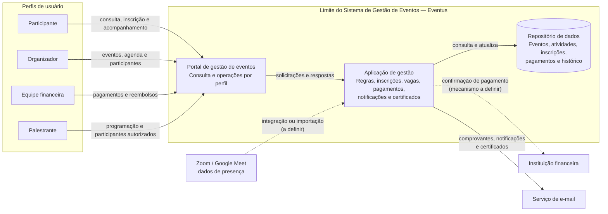
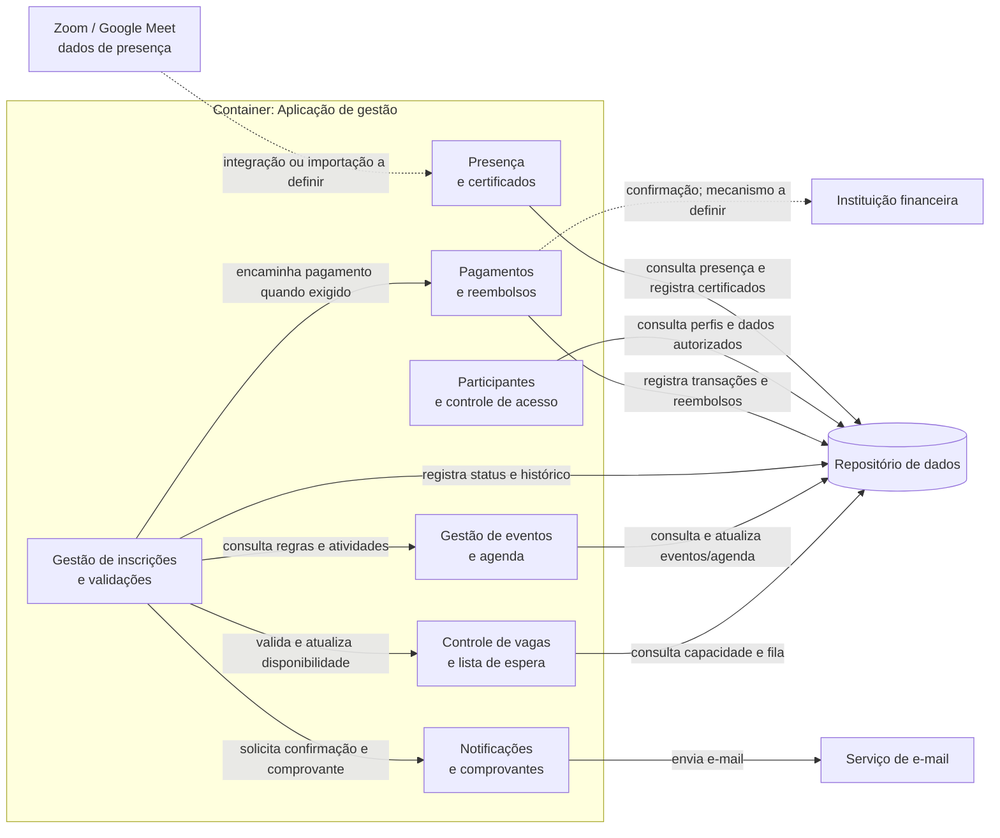
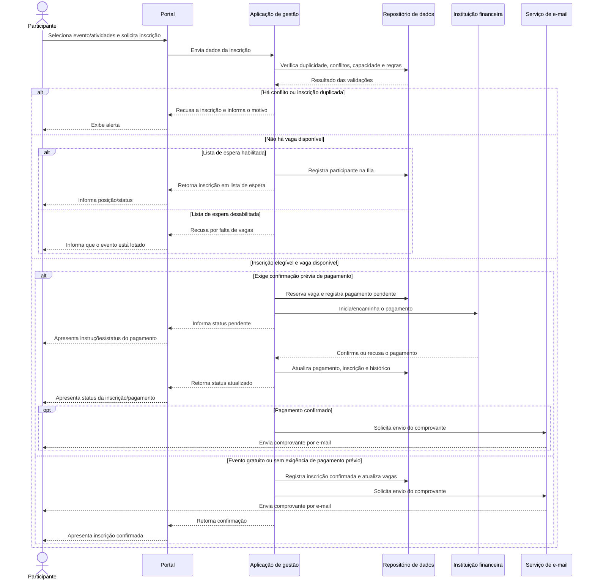

# Gestão de Eventos

Este repositório foi estruturado para registrar a análise e a especificação do projeto.

## Contexto do Projeto

A empresa Eventus organiza congressos, workshops e eventos corporativos. Atualmente, o gerenciamento das inscrições é realizado por meio de formulários on-line e planilhas eletrônicas, dificultando o controle de vagas, pagamentos, cancelamentos e emissão de certificados.

Com o crescimento do número de eventos realizados, a empresa decidiu desenvolver um sistema para centralizar essas atividades, oferecendo uma melhor experiência aos participantes e maior controle para os organizadores.

## Estrutura

- `analise/`: artefatos de análise inicial
- `especificacao/`: documentos de especificação em evolução

## Stakeholders Identificados e Interesses

- Participantes: inscrever-se em eventos, acompanhar inscrições, cancelar participação e emitir certificados.
- Organizadores: criar eventos, controlar vagas, acompanhar inscrições e gerenciar participantes.
- Equipe Financeira: confirmar pagamentos e controlar reembolsos.
- Palestrantes: consultar a programação e informações sobre participantes de suas atividades.
- Equipe de TI: desenvolver e manter o sistema.

## Reflexão sobre o Uso da Inteligência Artificial

### 1. Ferramenta GenAI Utilizada

- GitHub Copilot (produção dos artefatos)
- Claude Code (utilizado como revisor)

### 2. Apoio da IA nas diferentes etapas da atividade

A IA colaborou significativamente na elaboração dos documentos de Requisitos Funcionais (RF) e Requisitos Não Funcionais (RN). Embora algumas revisões tenham sido necessárias, seu uso permitiu antecipar o trabalho e organizar os requisitos com mais agilidade, além de possibilitar um cruzamento mais abrangente das informações. Dessa forma, foram identificados e incluídos itens que poderiam ser esquecidos caso a atividade fosse realizada exclusivamente de forma manual.

### 3. Sugestões da GenIA que foram aceitas

- Inclusão de critérios de segurança, tempo de resposta, acessibilidade e proteção de dados. Itens adicionais com destaque em relação aos demais, reforçando a necessidade de adoção e revisão.

### 4. Sugestões da GenIA que foram descartadas ou modificadas

- Duplicidade na lista de dúvidas e lacunas. Três pares de itens tratavam da mesma questão com redações diferentes. Consolidação gerando uma redução de 15 para 12 dúvidas reais.
- Incorporada a sugestão de bloqueio de RF e RN devido à existência de dúvida em aberto (DL).

### 5. Artefatos de especificação produzidos

- **Casos de Uso:** descrevem os fluxos de interação entre os usuários e o sistema, detalhando os objetivos, as etapas e as regras envolvidas. São importantes para organizar as funcionalidades e facilitar a validação dos requisitos pelos stakeholders.
- **Protótipos simples das telas:** representam a disposição inicial das informações e das funcionalidades nas telas do sistema. São importantes para validar a organização da interface e identificar ajustes de usabilidade antes da implementação.

## Etapa: Produção de soluções com diagrams as code

### Descrição do sistema

**Escopo.** O Sistema de Gestão de Eventos da Eventus centraliza a consulta e a administração de eventos e atividades, inscrições, vagas e lista de espera, pagamentos e reembolsos, notificações, acompanhamento de participantes e emissão de certificados. O sistema atende congressos, workshops e eventos corporativos, com uma política comum e configurações por evento. O fluxo de inscrição considera eventos gratuitos e pagos, disponibilidade de vagas e conflitos de horário.

**Nível da visão.** A visão estrutural apresenta dois níveis inspirados no C4: um diagrama de containers lógicos do sistema e um diagrama dos componentes conceituais dentro do container da aplicação. Eles mostram responsabilidades e relações, sem especificar implantação, tecnologias, protocolos, bancos de dados ou provedores. O diagrama comportamental detalha, em nível de sistema, a jornada de inscrição e seus principais ramos.

**Limites e responsabilidades.** Dentro do limite do sistema ficam o portal para os usuários, a aplicação que aplica as regras de negócio e o repositório conceitual de eventos, atividades, inscrições e respectivos estados. A aplicação valida capacidade, duplicidade e conflitos; controla reservas e lista de espera; registra os estados e o histórico; e coordena pagamentos, notificações e certificados. Participantes, organizadores, equipe financeira e palestrantes interagem com o sistema conforme seus perfis. A equipe de TI desenvolve e mantém a solução, mas não é um ator funcional. A instituição financeira é a fonte de confirmação do pagamento; o processamento do pagamento e o envio de e-mail são responsabilidades de serviços externos.

**Integrações.** O sistema deve enviar comprovantes, certificados e notificações por e-mail. A confirmação de pagamento vem da instituição financeira, mas o mecanismo de integração não foi escolhido. Para eventos on-line, a presença depende de dados do Zoom ou Google Meet; integração ou importação ainda não foi definida. Os traços pontilhados no diagrama indicam integrações cujo mecanismo permanece a definir.

**Restrições e lacunas.** Os requisitos definem regras de negócio, mas não uma arquitetura tecnológica. A confirmação financeira prévia se aplica apenas às inscrições que se enquadrarem em um critério ainda pendente ([DL-12](analise/duvidas-e-lacunas.md)). A seleção do nível de verificação de segurança, metas de desempenho e disponibilidade, retenção e exclusão de dados e verificação de acessibilidade também precisa ser concluída ([DL-09](analise/duvidas-e-lacunas.md)). Para certificados, ainda faltam definir a base de cálculo da frequência, o procedimento para listas presenciais e como obter dados de presença de plataformas on-line ([DL-04](analise/duvidas-e-lacunas.md)). O vencimento de boleto ou Pix deve liberar a vaga, mas a forma de determinar esse vencimento depende dos detalhes da integração ([DL-06](analise/duvidas-e-lacunas.md)). Essas decisões não são presumidas nos diagramas.

### Diagrama estrutural — nível Contêiner

### Diagrama estrutural — nível Componente

Este diagrama detalha o container lógico **Aplicação de gestão** acima. Os componentes representam separações de responsabilidade sugeridas pelos requisitos; não implicam módulos, serviços ou tecnologias já implementados.

### Diagrama comportamental — inscrição em evento

O fluxo resume o [UC-02 — Realizar inscrição](especificacao/casos-de-uso.md). A decisão sobre exigir confirmação prévia de pagamento permanece configurável/pendente conforme a [DL-12](analise/duvidas-e-lacunas.md).

### Decisões e ajustes sobre o rascunho da GenAI

- O rascunho dos diagramas foi produzido com GitHub Copilot (GenAI) e revisado à luz dos requisitos, regras de negócio, casos de uso e dúvidas documentados neste repositório.
- Separamos a visão estrutural em nível Contêiner e nível Componente. Os componentes são responsabilidades conceituais dentro da aplicação, não uma afirmação sobre a implementação atual.
- Evitamos atribuir ao projeto tecnologias, protocolos, bancos de dados ou provedores ainda não selecionados.
- Separamos a instituição financeira, que é a fonte de confirmação, do mecanismo de pagamento, ainda não especificado; a confirmação prévia aparece como ramo condicional, não como regra para todo evento pago.
- Incluímos as validações de duplicidade/conflito, a alternativa de lista de espera e a reserva da vaga quando o pagamento é iniciado, conforme o UC-02 e as regras associadas.
- Representamos como pontilhadas as integrações cujo mecanismo permanece em aberto e não afirmamos que Zoom ou Google Meet já estejam integrados.
- Limitamos o fluxo comportamental à jornada de inscrição; cancelamento, reembolso, convocação da lista de espera e emissão de certificados permanecem cobertos pelos casos de uso e pelas regras referenciados acima, sem presumir detalhes de implementação.
